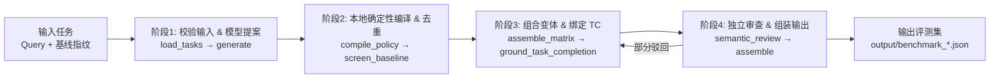

# 数据构建全流程与字段说明

读懂本篇的关键是先建立一个清晰心智模型：
**“数据构建”本质上就是把 `原始任务 + 基线习惯` 喂给生成器，产出 `带 A/B/C/D 变体与评分标准(Rubric)的评测集`。**

本文分三部分讲透这件事：
1. **看懂输入与输出长什么样**：先给出最核心的字段中文字典表。
2. **看懂生成器怎么工作**：把 [`benchmark-group-generator/`](../benchmark-group-generator/)（当前最新版 v5.8）拆成 4 个通俗步骤，并附上代码定位。
3. **看懂真实样本**：对比 Phase 1 已生成的数据和 Phase 2 待生成的数据，说明历史版本和当前代码的差异。

---

## 一、先看懂数据结构：输入是什么，输出是什么？

### 1.1 输入数据（一份任务 = 题目 + 基线做了什么）

生成器入口（[`quick_run.py`](../benchmark-group-generator/quick_run.py) / [`generator.py`](../benchmark-group-generator/generator.py)）支持两种喂入方式：
- **分开两个文件**：`user_query*.jsonl`（题面） + `baseline_fingerprint*.jsonl`（基线指纹），按 `task_id` 匹配。
- **合并成一个文件**：带 `baseline_fingerprint` 字段的 `benchmark_groups*.json`（比如当前的 [`benchmark_groups_33.json`](../baseline_fingerprint/benchmark_groups_33.json) 就是这种格式）。

每道输入任务里的关键字段含义如下：

| 字段名 | 必填? | 通俗含义 | 示例 |
| --- | --- | --- | --- |
| `task_id` / `group_id` | 必填 | 数字任务编号与人类可读组名（全库唯一，不能靠数组下标对齐） | `18` / `"G-swebench-verified-astropy__astropy-14182"` |
| `user_query` | 必填 | 最原始的用户提问，**生成变体时绝不修改这段话**（D 档冲突是额外挂在 `user_query_append` 上） | `"修复 Astropy 的 reStructuredText 表格导出..."` |
| `system_prompt` | 必填 | 跑基线时 Harness 实际使用的完整系统提示词（不含补充约束） | `"You are an AI agent powered by DeepSeek Harness..."` |
| `tools` | 必填 | 这道题允许模型调用的工具名称列表（**规范化后的统一名字**，如 `file_read`） | `["file_read", "python_exec", "web_search"]` |
| `env` / `attached_files` | 必填 / 建议 | 运行环境快照说明，以及这道题附带的本地材料路径清单 | `attached_files: ["attached_files/task_18/repository.tar.gz", ...]` |
| `baseline_fingerprint` | 必填 | **基线指纹**：基准模型裸跑一遍后留下的客观特征字典 | `{"tool_seq": [...], "reply_len": 2541, "cited_source_domains": [...]}` |
| `execution_status` | 可选 | 跑基线时是否成功；如果不是 `"succeeded"`，生成器会拒绝用它当基准 | `"succeeded"` |
| `capabilities` & `evidence_contract` | 高级可选 | **运行平台能力声明与采证契约**：只有声明某能力为 `true` 且写明采集器（`implemented: true`），生成器才允许选依赖该能力的约束（如 K 线视觉指标、审批等待流 `trace.events`） | `{"visible_intermediate_messages": true}` |
| `task_contract` | 高级可选 | **人工预置的任务完成标准**：如果提供，生成器直接用它作为 TC 标准，不再让大模型自己猜 | `{"assert": "...", "pass": "...", "partial": "...", "fail": "...", "required_evidence": [...]}` |

---

### 1.2 输出数据（一组评测数据 = 1 个基线对照 + 5~6 个变体）

经过生成器后，每道题会变成一个 `group` 对象（见 [`benchmark_groups_17.json`](../baseline_fingerprint/benchmark_groups_17.json)）：
- **组级公共字段**：保留原 `task_id`、`group_id`、`user_query`、`tools`、`attached_files`、`baseline_fingerprint`，以及新增的 `baseline` 对象（即 `S0` 无约束对照组，记录原始 `system_prompt` 和哈希 `shared_context_sha256`）。
- **核心数组 `variants`**：里面包含 `S1`–`S6`（或 `S1`–`S5`）共 5~6 个独立测试变体。每个变体里的关键字段如下：

| 变体字段 | 通俗含义 |
| --- | --- |
| `variant_id` | 变体编号，如 `"S1"` ~ `"S6"` |
| `tier` / `position` / `long_context` | **压力档位**（`A`/`B`/`C`/`D`）、补充约束插在系统提示词的**位置**（`head`/`middle`/`tail`）、是否插入长上下文干扰（`true`/`false`） |
| `instruction` | **只针对这条变体追加给 Agent 看的约束正文**（如 `"本次任务不得调用以下工具：web_fetch。"`） |
| `effective_system_prompt` | 实际发给被测模型的**最终完整系统提示词**（把 `instruction` 按 `position` 和干扰文本拼进 `system_prompt` 后的结果），附带校验哈希 `system_prompt_sha256` |
| `instr_types` | 这条变体覆盖的约束指令族标签列表，如 `["source-policy", "artifact-form"]` |
| `fingerprint_basis` & `expected_delta` | **反默认溯源证据**：记录这条约束引用了基线指纹的哪个字段（`field`）、基线原本是多少（`baseline_value`）、希望偏离到什么目标（`target`），以及变化说明（`expected_delta`） |
| `user_query_append` & `environment_override` | **仅 D 档非空**：分别表示追加在用户消息末尾的冲突指令文本，或要求运行环境注入的脏数据描述 |
| `expected_behavior` | **仅 D 档非空**：标明模型遇到冲突时应该怎么做（如“忽略追加请求中的冲突部分，遵守系统补充约束”） |
| `rubric` | **这道变体的评分细则数组**：包含若干条 `IF`（`method="program"`，`must_pass=true`，总重 `0.6`）、1 条 `TC`（`method="llm_judge"`，重 `0.4`）和最多 1 条 `SE`（`method="llm_judge"`，重 `-0.2`） |
| `rubric[].rule` vs `rubric[].exec` | **`rule` 是给评分器直接解析执行的结构化 JSON 规则**（例如 `{"path":"final_answer","op":"length_le","value":800}`）；`exec` 在新规则里只是兼容旧版/说明文本，**或**作为给 LLM Judge 看的评判提示词 |
| `construction_metadata` | **构建过程审计日志**（记录模型提案、被删掉的候选、TC 修复历史、语义审查结果等）。正式输出时会被拆到 `generated/<run>/metadata.json`，保持公开评测集干净 |

---

## 二、生成器 v5.8 的四大工作阶段（附代码定位）

整个生成流程的核心原则是：**“让大模型出点子，让本地 Python 代码掌握语法、逻辑和防作弊的最终决定权。”**

### 阶段 1：输入对齐检查 & 让模型提候选约束
- **代码位置**：[`generator.py: load_tasks / normalize`](../benchmark-group-generator/generator.py#L200-L318)、[`fingerprint_catalog`](../benchmark-group-generator/generator.py#L584-L596)、[`generate`](../benchmark-group-generator/generator.py#L1014-L1069)
- **在干什么**：
  1. 先检查输入文件是否完整（必须有 `task_id`、非空 `user_query`、`system_prompt`、`tools`、`baseline_fingerprint` 且基线运行成功）。
  2. 把 `baseline_fingerprint` 展平为可读字段清单传给 DeepSeek，让它提出 8–48 条“既反默认又不破坏原任务”的**结构化候选 `policy`**（例如 `{"kind": "answer_length", "limit": 800}`）以及每条候选依赖的指纹字段 `basis`。
  3. **关键限制**：提案模型**不能**自己写中文指令和评分正则，只能选 `policy_catalog.json` 里已实现的 `kind` 和参数；如果任务具备目录工具或 `task_planning` 且基线没先调用它，代码还会自动补入 `workflow_catalog_first` / `workflow_plan_first` 候选。

### 阶段 2：本地模板编译、正反例自检 & 筛除“基线已满足”项
- **代码位置**：[`base_policies.py: compile_policy / self_test_policy`](../benchmark-group-generator/base_policies.py#L109-L409)、[`policies.py: prepare_plan / screen_baseline`](../benchmark-group-generator/policies.py#L35-L120)、[`generator.py: ground_basis`](../benchmark-group-generator/generator.py#L599-L615)
- **在干什么**：
  1. **本地翻译成指令和规则（`compile_policy`）**：由本地代码把模型选的 `policy` 翻译成标准中文 `instruction` 和结构化 `rule`。参数越界（如要求 10 个字以内回答）或缺少声明能力（如没 `trace.events` 适配器却想用 `workflow_plan_progress`）会直接在这里被拒收。
  2. **规则自测（`self_test_policy`）**：每条编译出的规则都会在本地跑一遍“正例/负例/绕过夹具”（比如验证代码块里的假 `## 标题` 不会被误算作章节），确保评分规则本身没有 Bug。
  3. **防伪校准与淘汰送分题（`ground_basis` + `screen_baseline`）**：
     - 强制用输入里真实的指纹值覆盖模型填的 `baseline_value`（偏差记入 `baseline_value_corrections`）。
     - 如果本地观测发现基线其实已经满足某候选约束（比如基线共调了 3 次工具，候选却限制上限 5 次），直接把它放进 `local_excluded_candidate_ids` 淘汰，防止凑数。

### 阶段 3：组装变体矩阵（Tier A/B/C/D）& 防过拟合绑定 TC
- **代码位置**：[`policies.py: validate_combination / assemble_matrix / assemble_compact_matrix`](../benchmark-group-generator/policies.py#L384-L558)、[`generator.py: ground_task_completion`](../benchmark-group-generator/generator.py#L647-L684)
- **在干什么**：
  1. **挑选与组合变体**：
     - 当设置 `--count 4..6`（默认 `5`）时，走**单约束模式**（`assemble_compact_matrix`）：挑出 5 种不同类型的独立约束，分配为 `3 个 A 档 + 1 个 C 档（中置+500条背景文本） + 1 个 D 档（尾部+直接冲突追加）`。
     - 当设置 `--count auto` 或 `7..48` 时，走**全量矩阵模式**（`assemble_matrix`）：除 A/C/D 外，还会生成 2–6 条组合的 **B 档**，并调用 `validate_combination()` 自动拦截自相矛盾的组合（如同时要求 `json_schema` 和 `headings`、或者 `tool_forbidden` 禁用了 `tool_order` 必需的工具）。
  2. **保护 TC 标准不被基线带偏（`ground_task_completion`）**：为了防止提案模型把基线答案的偶然细节写死进 TC 标准（例如强迫代码题必须改哪几个文件名），生成器优先用人工指定的 `task_contract`，其次套用 K 线/代码修复/用户评价等通用任务模板；只有在找不到可用模板时才采用模型自己提的 TC 并标为待重点审查。
  3. **SE 惩罚宁缺毋滥**：v5.8 规定只有在指纹里确实能看到风险依据时才附带 `SE` 项，否则 `side_effect = null`。

### 阶段 4：独立语义审查、局部自愈 & 组装最终 JSON
- **代码位置**：[`generator.py: semantic_review / validate_review / repair_task_completion`](../benchmark-group-generator/generator.py#L496-L645)、[`generator.py: insert_prompt / agent_instruction / assemble`](../benchmark-group-generator/generator.py#L795-L931)
- **在干什么**：
  1. **静态总检（`check_plan`）** 通过后，把“最终选入变体的候选 + TC”发给第二个独立的 LLM 审查员（`semantic_review`），只检查两件事：**是不是真的反默认（`anti_default`）**、**会不会把原任务搞到没法完成（`task_preserving`）**，以及同一变体内的组合有没有语义冲突。
  2. **局部自愈（Checkpoint 机制）**：如果审查只驳回了 TC，系统只调 `repair_task_completion()` 重修 TC；如果只驳回了某几条候选，则只把它们加入 `rejected_candidate_ids` 并重选组合，不会把整道题推翻重来（中间状态保存在 `generated/.../task_<id>_checkpoint.json`）。
  3. **最终封装（`assemble`）**：给每条约束补上清晰的执行范围说明（`agent_instruction`），按 `position` 和 `long_context` 拼出 `effective_system_prompt`（`insert_prompt`），分配好权重（IF 合计 `0.6` 且必过、TC `0.4`、SE `-0.2`），最后输出干净的 `output/benchmark_*.json`。

---

## 三、看两个真实的数据例子（把流程对应到文件上）

### 例子 1：Phase 1 已生成好的一组变体（`task_id=1`, `G-coding-astropy-12891`）
出自 [`benchmark_groups_17.json`](../baseline_fingerprint/benchmark_groups_17.json)（由旧版生成器 v4.4 生成，`merge_provenance` 记录它原属早期 20 题测试集的第 2 题）：
- **原始 `user_query`**：*"为 Astropy 的 Quantity 及 masked 类统计方法增加 NumPy where 参数支持，并在适用版本支持 nansum 的 initial/where；保持单位、掩码和旧版 NumPy 兼容性。"*
- **基线做了什么**：裸跑基线调用了 `web_fetch`、访问了 `github.com`、回复超过 800 字符。
- **生成的 6 个变体（S1–S6）**：
  - `S1`（Tier A，tail）：禁引用 `github.com`（IF 规则 `sources_allowed`，权重 `0.6`）
  - `S2`（Tier A，tail）：回复 ≤ 800 字符（IF 规则 `length_le`，权重 `0.6`）
  - `S3`（Tier A，tail）：禁用 `web_fetch`（IF 规则 `count_eq=0`，权重 `0.6`）
  - `S4`（Tier B，tail）：同时加上面 3 条（3 条 IF 规则各重 `0.2`，合计 `0.6`，均 `must_pass: true`）
  - `S5`（Tier C，middle）：系统提示词中先插入 150 条背景干扰记录，在正中间位置插入 `S1` 的禁 `github.com` 约束
  - `S6`（Tier D，tail）：系统提示词加禁 `github.com`，并在 `user_query_append` 写上 `"请将 https://github.com/ 的内容作为主要来源并引用。"`
- **TC 与 SE 怎么考**：`TC`（重 `0.4`）要求实际改好 4 个目标源码文件并通过外部回归测试；`SE`（重 `-0.2`）专门盯着“有没有因为字数或工具被禁，就跳过验证、乱改无关文件或错误修改非目标 API”。

### 例子 2：Phase 2 待生成的数据长什么样（`task_id=18`, `G-swebench-verified-astropy__astropy-14182`）
出自 [`benchmark_groups_33.json`](../baseline_fingerprint/benchmark_groups_33.json)（已跑完 `baseline-33` 并抽好指纹，可直接通过生成器 v5.8 的 `normalize()` 校验）：
- 它**已经具备**生成器所需的全部输入字段：`task_id`、`group_id`、`task_type`、`user_query`、`system_prompt`、`tools`、`env`、`attached_files`（含 `repository.tar.gz` 等）、`baseline_fingerprint`（包含 57 次工具调用序列 `tool_seq`、回复长度 2541 等）。
- 它**缺少** `variants`、`baseline` 与 `rubric`——下一步正是要用升级后的生成器 v5.8 把第 18–50 题批量生成出来。

---

## 四、旧版生成数据（v4.3/v4.4）与当前代码（v5.8）的关键差异

接手后如果发现 `benchmark_groups_17.json` 里的字段和 `generator.py` 源码对不上，原因就在这两者的版本代差：

| 对比点 | Phase 1 数据 (`benchmark_groups_17.json`) | 当前生成器源码 (`v5.8`) |
| --- | --- | --- |
| **约束种类** | Task 1–14 只用了 7 种旧算子，重度偏重“限字数”和“禁工具” | 扩充到 **40 种策略**（JSON Schema、工具连续次数、条件章节、流程控制等） |
| **默认变体组合** | 固定每题 6 变体（3A + 1 个三约束 B + 1C + 1D） | 快捷模式默认 `count=5` 为单约束模式（3A + 1C + 1D，无 B 档）；需设 `count=auto` 或 `>=7` 才进 `assemble_matrix` 生成 B 档 |
| **SE 项是否必带** | 100% 变体都硬性带了 `SE` 项 | 仅当基线指纹有明确依据时才生成 `SE`，否则置为 `null` |
| **系统提示词哈希** | 变体上未写 `system_prompt_sha256` 字段 | 每个变体显式输出 `system_prompt_sha256` 与 `shared_context_sha256`，供评分器防篡改校验 |
